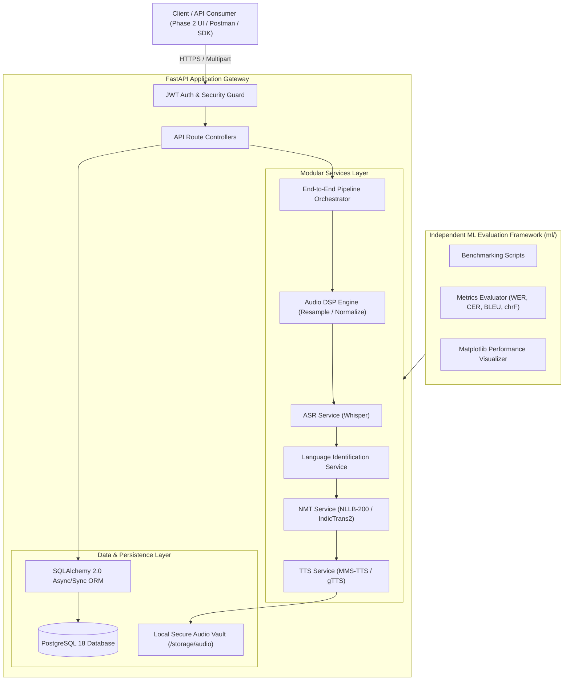
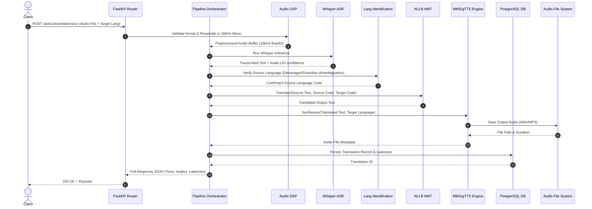
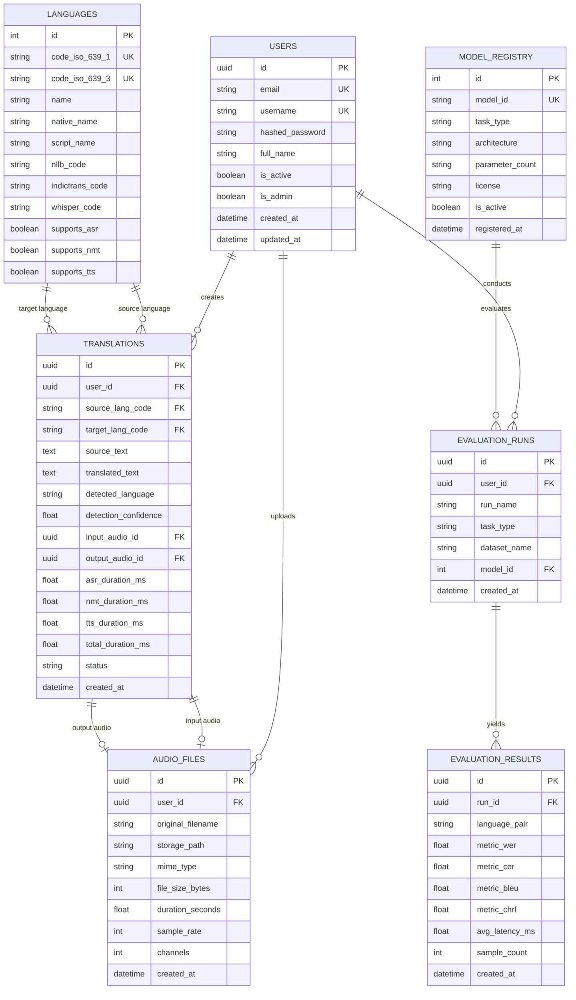

# BhashaAI – System Architecture & Technical Design

## 1. High-Level Architecture Overview

BhashaAI implements a decoupled, service-oriented architecture specifically designed for low-resource CPU inference on Indian languages.



---

## 2. Voice Translation Pipeline Dataflow



---

## 3. Database Schema Design (Entity-Relationship)



---

## 4. Backend Directory Structure

```
sd/
├── backend/
│   ├── app/
│   │   ├── api/
│   │   │   ├── v1/
│   │   │   │   ├── endpoints/
│   │   │   │   │   ├── auth.py
│   │   │   │   │   ├── translate.py
│   │   │   │   │   ├── languages.py
│   │   │   │   │   ├── audio.py
│   │   │   │   │   ├── evaluation.py
│   │   │   │   │   └── health.py
│   │   │   │   └── router.py
│   │   ├── core/
│   │   │   ├── config.py
│   │   │   ├── security.py
│   │   │   └── languages_config.py
│   │   ├── database/
│   │   │   ├── session.py
│   │   │   └── base.py
│   │   ├── models/
│   │   │   ├── user.py
│   │   │   ├── language.py
│   │   │   ├── translation.py
│   │   │   ├── audio.py
│   │   │   └── evaluation.py
│   │   ├── schemas/
│   │   │   ├── user.py
│   │   │   ├── translation.py
│   │   │   ├── language.py
│   │   │   ├── audio.py
│   │   │   └── evaluation.py
│   │   ├── services/
│   │   │   ├── asr/
│   │   │   │   ├── service.py
│   │   │   │   └── audio_processor.py
│   │   │   ├── translation/
│   │   │   │   ├── service.py
│   │   │   │   └── normalizer.py
│   │   │   ├── tts/
│   │   │   │   ├── service.py
│   │   │   │   └── mms_engine.py
│   │   │   ├── language_detection/
│   │   │   │   ├── service.py
│   │   │   │   └── heuristics.py
│   │   │   └── pipeline.py
│   │   ├── utils/
│   │   │   ├── audio_utils.py
│   │   │   └── logger.py
│   │   └── main.py
│   ├── alembic/
│   │   ├── env.py
│   │   ├── script.py.mako
│   │   └── versions/
│   ├── tests/
│   │   ├── test_auth.py
│   │   ├── test_database.py
│   │   ├── test_asr.py
│   │   ├── test_nmt.py
│   │   ├── test_tts.py
│   │   ├── test_langdetect.py
│   │   ├── test_endpoints.py
│   │   └── test_pipeline.py
│   ├── alembic.ini
│   ├── requirements.txt
│   └── .env.example
├── ml/
│   ├── datasets/
│   │   ├── test_sentences.json
│   │   └── test_audio_manifest.json
│   ├── preprocessing/
│   │   └── audio_cleaner.py
│   ├── evaluation/
│   │   ├── asr_evaluator.py
│   │   └── nmt_evaluator.py
│   ├── experiments/
│   │   └── benchmark_runner.py
│   ├── benchmarks/
│   │   └── results/
│   └── scripts/
│       └── generate_plots.py
├── storage/
│   └── audio/
│       ├── uploads/
│       └── generated/
├── MODEL_SELECTION.md
├── ARCHITECTURE.md
├── DEVELOPMENT_PLAN.md
├── PROJECT_STATUS.md
├── DEVELOPMENT_LOG.md
└── PHASE_1_COMPLETION_REPORT.md
```

