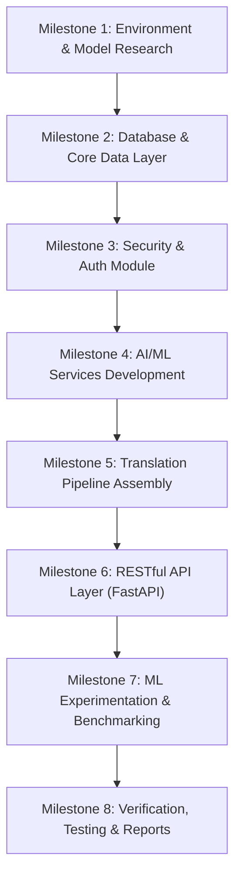

# BhashaAI – Phase 1 Development Plan

## 1. Project Overview & Scope
- **Project Name:** BhashaAI (AI-Powered Voice Translator for Indian Languages)
- **Academic Degree:** MCA Final Year Project (AI & Machine Learning Specialization)
- **Scope Restriction:** Phase 1 focuses exclusively on AI/ML model integration, backend engineering, PostgreSQL database design, speech & text pipelines, evaluation frameworks, and technical architecture. The complete UI frontend will be developed in Phase 2.

---

## 2. Phase 1 Implementation Milestones

### Milestone 1: Environment & Model Research (Completed)
- Hardware profiling (CPU, RAM, Storage).
- Dependency verification (PyTorch, Transformers, PostgreSQL, Audio stack).
- Rigorous model evaluation across ASR, NMT, TTS, and LID.
- Formulation of `MODEL_SELECTION.md` and architecture documentation.

### Milestone 2: Database & Core Data Layer
- PostgreSQL connection & engine pooling configuration.
- SQLAlchemy 2.0 ORM models for:
  - `User` (Identity, hashed credentials, roles)
  - `Language` (ISO codes, scripts, directionality, model metadata)
  - `Translation` (Source text, translated text, latency, audio references)
  - `AudioFile` (File paths, format, sample rate, duration, size)
  - `ModelRegistry` (Model name, version, task, status, memory footprint)
  - `EvaluationRun` (Experiment batch, model under test, dataset used)
  - `EvaluationResult` (WER, CER, BLEU, chrF, latency metrics)
- Alembic database migration scripts for reproducible schema versioning.

### Milestone 3: Security & Auth Module
- Cryptographically secure password hashing via `passlib[bcrypt]` / `bcrypt`.
- Stateless JWT authentication (access tokens, token expiration, payload verification).
- Role-based dependency injection for user-level data isolation.
- File upload sanitization, mime-type validation, and size guardrails (maximum 25MB).

### Milestone 4: AI/ML Services Development
- **Language Detection Service (`services/language_detection/`):**
  - Text-based N-gram profiling combined with exact Unicode block boundaries.
  - Devanagari linguistic heuristic classifier for Marathi vs. Hindi.
  - Confidence scoring and fallback handling.
- **ASR Service (`services/asr/`):**
  - Audio validation (wav, mp3, ogg, flac, m4a).
  - Audio preprocessing pipeline: stereo-to-mono, 16 kHz resampling, peak normalization, silence trimming.
  - Noise reduction experimentation using spectral gating.
  - Lazy-loaded Whisper Small/Base model inference.
- **NMT Service (`services/translation/`):**
  - Transformer Seq2Seq translation using Meta NLLB-200 distilled 600M (`facebook/nllb-200-distilled-600M`).
  - Modular interface supporting IndicTrans2.
  - Text normalization, token truncation, batching, and language code mapping.
- **TTS Service (`services/tts/`):**
  - Local neural TTS via Facebook MMS-TTS (VITS architecture) per language.
  - Online fallback via gTTS with explicit telemetry headers.
  - WAV/MP3 generation, disk persistence, and audio metadata extraction.

### Milestone 5: End-to-End Translation Pipeline
- Pipeline Orchestrator (`services/pipeline.py`):
  $$\text{Audio Input} \longrightarrow \text{DSP Preprocessing} \longrightarrow \text{ASR} \longrightarrow \text{LID} \longrightarrow \text{NMT} \longrightarrow \text{TTS} \longrightarrow \text{Audio Output}$$
- High-resolution timing metrics per stage (ASR time, NMT time, TTS time, total latency).
- Fault-tolerant graceful degradation with informative diagnostic logs.

### Milestone 6: RESTful API Layer
- Clean FastAPI architecture with automatic OpenAPI/Swagger documentation.
- Endpoints:
  - `/api/v1/auth`: Register, Login, Current User, Token refresh.
  - `/api/v1/languages`: List supported languages, check compatibility matrix.
  - `/api/v1/translate/text`: Direct neural text translation.
  - `/api/v1/translate/voice`: Multipart voice translation pipeline.
  - `/api/v1/translations`: History retrieval, pagination, record deletion.
  - `/api/v1/audio`: Secure audio streaming, downloading, and verification.
  - `/api/v1/evaluation`: Model registry inspection, benchmark query endpoints.
  - `/health`: System health and hardware memory diagnostics.

### Milestone 7: ML Experimentation & Benchmarking (`ml/`)
- Test dataset curation for all 10 languages (using verified sample sentences and audio).
- Quantitative metrics computation:
  - ASR: Word Error Rate (WER) & Character Error Rate (CER) via `jiwer`.
  - NMT: BLEU score and chrF via `sacrebleu`.
  - Latency: Cold vs. Warm inference latency across models.
- CSV result generation and Matplotlib comparative visualization graphs.

### Milestone 8: Verification & Phase 1 Completion
- Automated Pytest test suite covering unit, integration, and endpoint tests.
- End-to-end voice translation demonstration on live audio.
- Preparation of `PHASE_1_COMPLETION_REPORT.md`.

