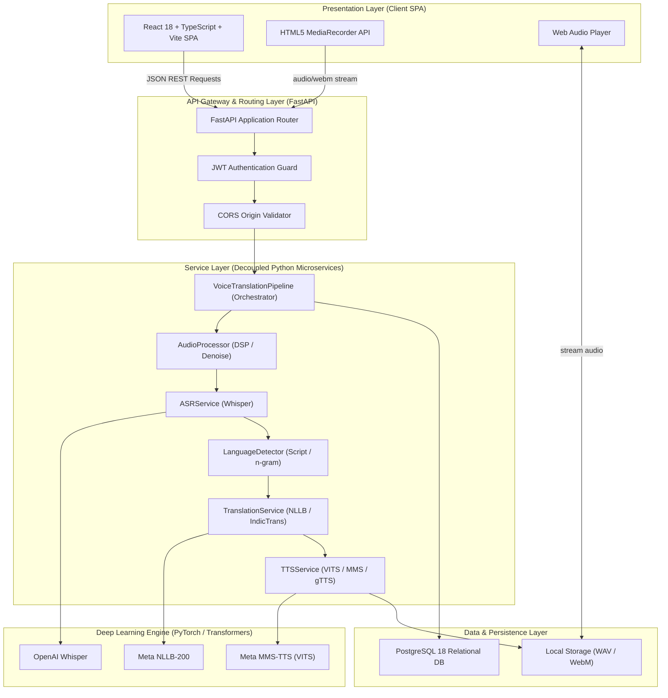
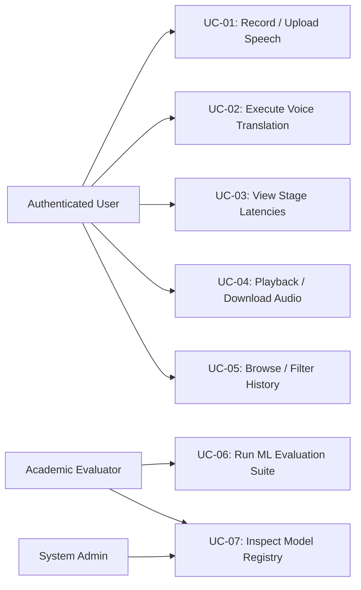
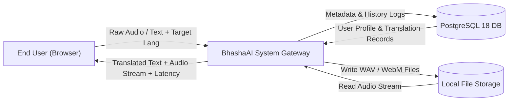
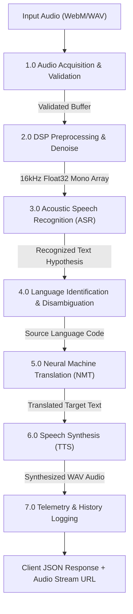
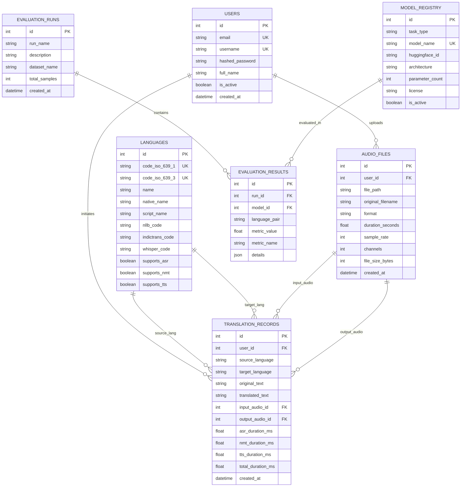
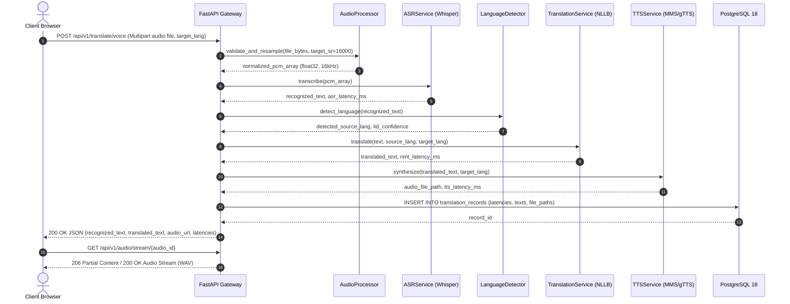
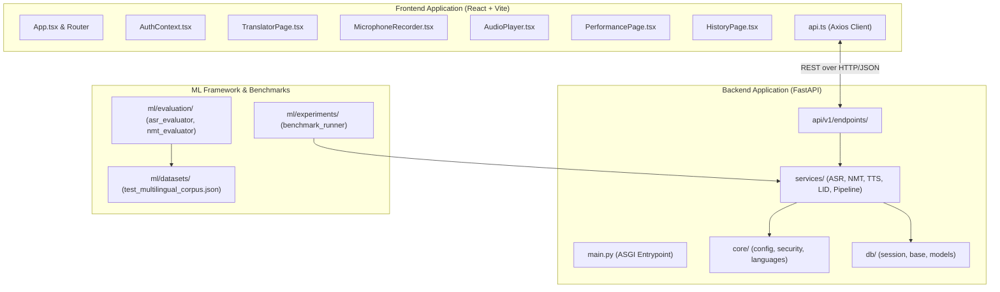

# CHAPTER 4 – SYSTEM DESIGN

## 4.1 High-Level Architectural Design

BhashaAI is designed as a decoupled, multi-tier software architecture comprising five core layers:
1. **Presentation Layer (Client SPA):** React 18, TypeScript, Tailwind CSS, Vite single-page application providing responsive UI components, audio recording via the HTML5 `MediaRecorder` API, real-time waveform playback, and telemetry charts.
2. **API Gateway & Routing Layer:** FastAPI asynchronous ASGI application enforcing CORS security policies, JWT authentication validation, request rate limiting, and multipart form-data handling.
3. **Business Logic & Service Layer:** Independent singletons for audio signal processing, ASR orchestration, language identification, neural translation, speech synthesis, and pipeline aggregation.
4. **Deep Learning Inference Engine:** Deep neural networks running on PyTorch and Hugging Face Transformers (`Whisper`, `NLLB-200`, `MMS-TTS`, `gTTS`).
5. **Persistence & Storage Layer:** PostgreSQL 18 relational database engine managed via SQLAlchemy 2.0 ORM and Alembic schema migrations, alongside local disk storage for audio artifacts.



---

## 4.2 Use Case Modeling

The system interacts with three primary actors:
- **Guest / Unregistered User:** Explores landing page, reviews supported language matrix, registers a new account, logs in.
- **Authenticated User:** Performs real-time speech recording, uploads audio files, triggers voice and text translations, reviews stage-by-stage latencies, listens to translated audio, downloads generated speech, and searches/filters translation history.
- **Academic Evaluator / Admin:** Executes automated evaluation harnesses, inspects WER/CER/BLEU metrics, reviews model registry specifications, and inspects database records.



---

## 4.3 Data Flow Modeling

### 4.3.1 DFD Level 0 (Context Diagram)
The Context Diagram depicts the system boundary and fundamental data exchanges between external entities and BhashaAI.



### 4.3.2 DFD Level 1 (Detailed Voice Pipeline Flow)
The Level 1 diagram decomposes the voice translation pipeline into its discrete transformation processes.



---

## 4.4 Entity-Relationship (ER) Design

The relational database model comprises 7 normalized tables designed to ensure referential integrity, eliminate data redundancy, and index search queries:



---

## 4.5 Sequence Modeling: End-to-End Voice Translation

The sequence diagram illustrates the synchronous and asynchronous messaging flow between the client application, API gateway, and internal ML processing components.



---

## 4.6 Component & Package Architecture

The system is decomposed into cleanly isolated Python modules and React component hierarchies:



---

## 4.7 API Contract Specifications

### 1. Voice Translation Endpoint
- **Route:** `POST /api/v1/translate/voice`
- **Content-Type:** `multipart/form-data`
- **Request Parameters:**
  - `file`: Binary audio file (`audio/wav`, `audio/webm`, `audio/mpeg`). Required.
  - `target_language`: ISO 639-1 target language code (e.g., `'en'`, `'hi'`, `'ta'`). Required.
  - `source_language`: ISO 639-1 source language code (optional, defaults to automatic detection).
  - `apply_denoise`: Boolean flag indicating whether spectral noise subtraction should be applied.
- **Success Response (200 OK):**
```json
{
  "id": 42,
  "source_language": "hi",
  "target_language": "en",
  "recognized_text": "नमस्ते, आप कैसे हैं?",
  "detected_language": "hi",
  "translated_text": "Hello, how are you?",
  "output_audio_url": "/api/v1/audio/stream/84",
  "latencies": {
    "dsp_ms": 42.1,
    "asr_ms": 1148.5,
    "lid_ms": 14.2,
    "nmt_ms": 782.9,
    "tts_ms": 479.3,
    "total_ms": 2467.0
  },
  "created_at": "2026-11-13T10:15:30.123456"
}
```

### 2. Text Translation Endpoint
- **Route:** `POST /api/v1/translate/text`
- **Content-Type:** `application/json`
- **Request Body:**
```json
{
  "source_text": "भारत एक महान और सुंदर देश है।",
  "target_language": "gu",
  "source_language": "hi"
}
```
- **Success Response (200 OK):**
```json
{
  "id": 43,
  "source_language": "hi",
  "target_language": "gu",
  "original_text": "भारत एक महान और सुंदर देश है।",
  "translated_text": "ભારત એક મહાન અને સુંદર દેશ છે.",
  "latencies": {
    "lid_ms": 12.0,
    "nmt_ms": 745.2,
    "total_ms": 757.2
  }
}
```

### 3. Audio Streaming Endpoint
- **Route:** `GET /api/v1/audio/stream/{audio_id}`
- **Response:** Binary audio stream (`audio/wav` or `audio/webm`), supporting HTTP range headers (`206 Partial Content`) for instant browser seeking and waveform scrubbing.
