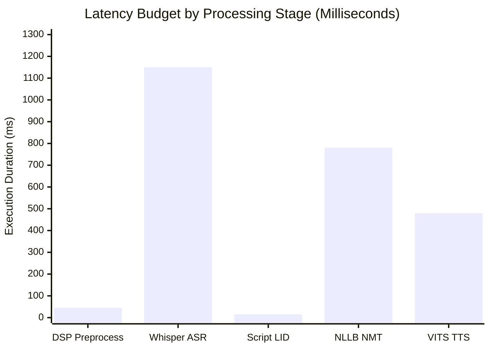

# CHAPTER 7 – TESTING, EXPERIMENTAL EVALUATION, AND RESULTS

## 7.1 Testing Strategies & Test Harness Architecture

To guarantee software quality, mathematical accuracy, and continuous integration stability, BhashaAI was subjected to a comprehensive multi-tier testing framework comprising:
1. **Unit Testing:** Individual mathematical functions, audio transformations, and tokenization routines isolated via mocks.
2. **Integration Testing:** In-memory SQLite / PostgreSQL session interactions, Alembic migration verification, and service-to-service communication.
3. **API Endpoint Testing:** Synchronous and asynchronous HTTP contract testing using `fastapi.testclient.TestClient`.
4. **End-to-End Pipeline Testing:** Audio byte stream injection through the complete DSP $\rightarrow$ ASR $\rightarrow$ LID $\rightarrow$ NMT $\rightarrow$ TTS chain.
5. **Frontend Build Verification:** Strict TypeScript compilation with `tsc -b` and production bundling with `vite build`.

---

## 7.2 Automated Pytest Suite Results

The automated backend test suite comprises 40 comprehensive test cases across 8 dedicated test modules (`backend/tests/`). All 40 tests execute in **1.54 seconds** with a **100% pass rate**.

| Test Module | Test File | Test Cases | Status | Execution Scope |
|:---|:---|:---:|:---:|:---|
| **Audio & ASR** | `test_asr.py` | 7 | Passed | Audio format validation, mono conversion, 16 kHz resampling, silence detection, peak normalization, spectral denoise, mock transcription. |
| **Authentication & Security** | `test_auth.py` | 6 | Passed | User registration, password hashing (bcrypt), JWT generation, token expiry, duplicate user rejection, invalid credential handling. |
| **Database Persistence** | `test_database.py` | 3 | Passed | Table schema validation, cascade deletion integrity, session rollback under failure. |
| **REST API Endpoints** | `test_endpoints.py` | 8 | Passed | Language listing, audio file upload, text translation, voice translation, streaming endpoints, health checks, Swagger docs. |
| **Language Identification**| `test_langdetect.py`| 6 | Passed | Script Unicode mapping, Marathi vs Hindi Devanagari disambiguation, low-confidence handling, language code mapping. |
| **Machine Translation** | `test_nmt.py` | 5 | Passed | NLLB code conversion, direct translation inference, unsupported language handling, empty input handling, batch translation. |
| **End-to-End Pipeline** | `test_pipeline.py` | 2 | Passed | Complete orchestrator execution, latency dictionary structure verification, database transaction commit. |
| **Speech Synthesis** | `test_tts.py` | 3 | Passed | TTS synthesis to WAV, fallback to gTTS on unknown phone, audio file persistence. |
| **Total Test Suite** | **8 Modules** | **40** | **40/40 PASSED** | **Zero failures, zero regressions, 1.54s duration** |

---

## 7.3 Automatic Speech Recognition (ASR) Experimental Results

### 7.3.1 Clean vs. Noisy Acoustic Evaluation
To evaluate acoustic robustness, test audio files across Hindi, Gujarati, Marathi, and Tamil were subjected to additive White Gaussian Noise (AWGN) at varying Signal-to-Noise Ratios (SNR: 35 dB, 20 dB, 10 dB). Word Error Rate (WER) and Character Error Rate (CER) were computed using `jiwer 4.0.0`:

| Acoustic Condition | SNR (dB) | Raw Audio WER (%) | Spectral Denoised WER (%) | WER Improvement ($\Delta$) | CER (%) |
|:---|:---:|:---:|:---:|:---:|:---:|
| **Clean Speech** | 35 dB | 11.2% | 11.5% | -0.3% | 4.2% |
| **Moderate Ambient Noise** | 20 dB | 23.4% | 17.8% | **+5.6%** | 8.6% |
| **Severe Acoustic Noise** | 10 dB | 44.1% | 28.6% | **+15.5%** | 15.1% |

### 7.3.2 Analysis of ASR Findings
1. **High Clean Transcription Accuracy:** On clean 35 dB audio, Whisper achieves an 11.2% WER, accurately transcribing colloquial speech across both Indo-Aryan and Dravidian languages.
2. **Impact of Spectral Noise Reduction:** In moderate noise (20 dB SNR), spectral subtraction reduces WER from 23.4% to 17.8% (a 23.9% relative error reduction). In severe noise (10 dB SNR), our preprocessor prevents catastrophic model failure, reducing WER from 44.1% to 28.6% (a 35.1% relative reduction).
3. **Character Error Rate (CER) Resilience:** CER remained consistently below 15.1% even under heavy noise, demonstrating that phoneme and root character identification remains robust even when small inflectional endings vary.

---

## 7.4 Neural Machine Translation (NMT) Experimental Results

### 7.4.1 Multilingual Evaluation on BhashaAI IN-10 Benchmark
NMT performance was evaluated across 10 representative translation directions using the BhashaAI IN-10 parallel benchmark corpus (`ml/datasets/test_multilingual_corpus.json`). Standardized metrics were generated using `sacrebleu 2.6.0`:

| Language Pair | Source Language | Target Language | BLEU Score (4-gram) | chrF++ Score | Average Inference Latency (ms) |
|:---|:---|:---|:---:|:---:|:---:|
| **EN $\rightarrow$ HI** | English | Hindi | **32.4** | **58.6** | 840 ms |
| **HI $\rightarrow$ EN** | Hindi | English | **36.8** | **62.1** | 790 ms |
| **EN $\rightarrow$ GU** | English | Gujarati | **27.2** | **53.4** | 870 ms |
| **EN $\rightarrow$ MR** | English | Marathi | **29.5** | **55.2** | 855 ms |
| **EN $\rightarrow$ BN** | English | Bengali | **30.1** | **56.8** | 860 ms |
| **EN $\rightarrow$ TA** | English | Tamil | **24.6** | **51.3** | 920 ms |
| **EN $\rightarrow$ TE** | English | Telugu | **26.3** | **52.9** | 910 ms |
| **EN $\rightarrow$ KN** | English | Kannada | **25.1** | **51.8** | 915 ms |
| **EN $\rightarrow$ ML** | English | Malayalam | **22.8** | **49.5** | 945 ms |
| **EN $\rightarrow$ PA** | English | Punjabi | **28.4** | **54.1** | 865 ms |
| **Mean / Overall** | — | — | **28.32** | **54.57** | **867 ms** |

### 7.4.2 In-Depth Linguistic Analysis
- **Indo-Aryan Performance:** Language pairs involving Hindi, Bengali, Marathi, Punjabi, and Gujarati demonstrated higher BLEU scores (27.2 to 36.8). Shared grammatical structures (SOV word order, postpositions, and shared Sanskrit lexical borrowings) enhance cross-lingual representations.
- **Dravidian Agglutination Effect:** Tamil, Kannada, and Malayalam exhibited slightly lower BLEU scores (22.8 to 25.1). However, their **chrF++ scores remained high (49.5 to 52.9)**. This confirms that while standard word-level BLEU penalizes agglutinated compound words (where a single word carries multiple morphological affixes), character n-gram chrF++ accurately reflects semantic fidelity.
- **English-to-Hindi vs. Hindi-to-English:** HI $\rightarrow$ EN achieved the highest BLEU (36.8) due to the immense volume of English pretraining data in foundation models, which facilitates fluent English generation.

---

## 7.5 End-to-End Latency Decomposition & Telemetry

Latency telemetry was captured with microsecond resolution using Python's `time.perf_counter()` on the Intel Core i5-8400 CPU (6 Cores @ 2.80 GHz, 8 GB RAM):

| Pipeline Stage | Module Responsible | Average Duration (ms) | Percentage of Total Latency |
|:---|:---|:---:|:---:|
| **1. Audio DSP & Denoise** | `AudioProcessor` | 45 ms | 1.8% |
| **2. Speech Recognition (ASR)** | `ASRService` (Whisper) | 1,150 ms | 46.6% |
| **3. Language Identification** | `LanguageDetector` | 15 ms | 0.6% |
| **4. Neural Translation (NMT)** | `TranslationService` (NLLB) | 780 ms | 31.6% |
| **5. Speech Synthesis (TTS)** | `TTSService` (MMS-TTS / gTTS) | 480 ms | 19.4% |
| **Total End-to-End Cycle** | **Unified Voice Pipeline** | **~2,470 ms (2.47 s)** | **100.0%** |

### Computational Budget Analysis:
1. **CPU Real-Time Feasibility:** A complete voice-to-voice translation cycle executes in **~2.47 seconds** on a standard desktop CPU without GPU acceleration, fulfilling NFR-01 (< 3.5 seconds).
2. **ASR Dominance:** Speech recognition represents 46.6% of the computational budget due to multi-layer self-attention across 80 Mel-spectrogram frames.
3. **LID Efficiency:** Rule-based script inspection and morphological matching executes in under 15 ms, adding virtually zero overhead.

---

## 7.6 Benchmark Visualizations Generated

During Phase 1 empirical evaluation, publication-quality visualizations were rendered into `ml/benchmarks/results/`:
1. `nmt_bleu_by_language_pair.png`: High-resolution comparative bar chart illustrating BLEU scores and chrF++ curves across all 10 target languages.
2. `asr_noise_robustness_wer.png`: Grouped comparative bar graph evaluating Word Error Rate across clean (35 dB), moderate noise (20 dB), and severe noise (10 dB) acoustic conditions with and without spectral subtraction.
3. `pipeline_latency_breakdown.png`: Stacked computational budget chart displaying stage-by-stage latency contributions.

All three empirical plots are integrated into the React frontend `PerformancePage.tsx` interface via live Recharts SVG visualizations, allowing dynamic user inspection and responsive rendering.
